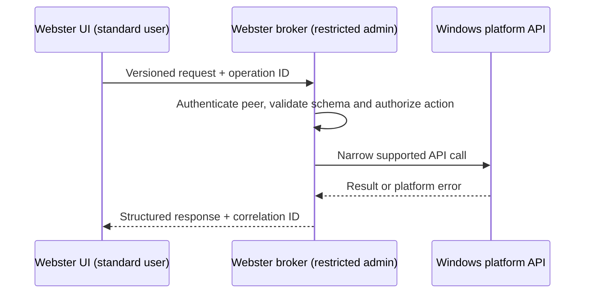

# Inter-Process Communication

**STATUS: PROPOSED.** IPC is required only where separation provides a concrete security, reliability or lifecycle benefit. Windows named pipes are a candidate, not a committed implementation.

## Contract Requirements

Requests contain protocol version, operation, bounded parameters and correlation ID. The server derives identity from the OS transport, not a caller-supplied username. Replies contain success/partial/failure, stable Webster error category, optional Windows error code, result payload and completion state. Sensitive values are excluded from logs.

The server enforces message-size limits, deadlines, cancellation rules, replay/idempotency policy, per-operation authorization, endpoint ACLs, safe shutdown and rate limits. Administrative operations are allow-listed, never arbitrary command execution. Compatibility changes are additive where possible; breaking changes increment major protocol version. See [secure IPC](../05-security/secure-ipc.md) and [IPC API](../14-api/ipc-api.md).
