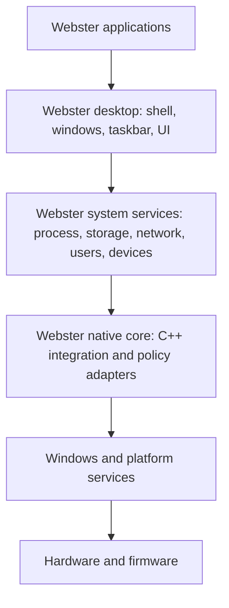

# Master Architecture

**STATUS: PROPOSED.** This is the target architecture for planning, not a description of code that exists.

## Architectural Decision

Phase 1 is a native Windows-integrated Webster environment/platform. Webster owns its experience, orchestration, APIs and policies where explicitly defined; Windows supplies the operating-system primitives. Phase 2 may move selected functions into more independent Webster processes or services while continuing to rely on Windows. A bootable independent OS is a future option requiring a separate approved research and architecture effort.

## Proposed Target Architecture

The diagram is conceptual. Not every application must depend on the desktop, and privileged capabilities must be mediated by narrow APIs rather than broad direct access.

## Layers and Ownership

| Layer | Webster responsibility | Phase 1 boundary |
|---|---|---|
| Applications | User-facing Webster tools and applications; consume documented APIs. | Webster-owned processes and UI. |
| Desktop | Shell experience, launch/navigation, windows, taskbar, menus, notifications and accessibility. | Runs as an ordinary Windows user-session application; Windows owns compositor and windowing primitives unless a component explicitly uses supported APIs. |
| System services | Webster orchestration, policy, discovery, presentation and management workflows. | Webster-owned user-mode processes; no implied kernel authority. |
| Native core | C++ adapters, validation, typed interfaces and controlled Windows API calls. | User-mode integration; privileged operations require an explicit broker/service boundary. |
| Windows/platform | Kernel, process/thread scheduler, virtual memory, object/handle security, drivers, PnP, filesystems, account logon, TCP/IP and supported management APIs. | Windows-owned dependency. |
| Hardware/firmware | Physical devices, firmware and platform behavior. | Accessed through Windows; Webster does not directly own a HAL or driver stack. |

## Phase Model

**Phase 1 — Windows-integrated platform (PROPOSED):** package and launch Webster applications on supported Windows versions; use documented APIs and Windows security principals. Do not replace Windows shell, kernel or system services by implication.

**Phase 2 — deeper native environment (FUTURE):** isolate Webster services, define stable contracts, and add narrowly scoped Windows service processes only where justified. Windows remains the host OS and security authority for underlying resources.

**Independent OS (FUTURE / RESEARCH):** only after an explicit decision, separately design and validate boot chain, kernel, memory/process model, drivers/HAL, filesystems, security authority, installer and hardware support. No current document implies these components exist.

## Cross-Cutting Requirements

- Keep unprivileged UI separate from privileged operations; authorize each request at the point of use.
- Prefer documented, supported Windows APIs. Treat WMI, registry, service control and device-management APIs as dependencies with availability and permission constraints.
- Give each component an owner, trust level, API contract, lifecycle and failure policy.
- Make failure visible and recoverable; management UI must not imply that an operation succeeded before the platform confirms it.
- Version IPC and persisted configuration. Avoid hidden shared mutable state and ambient authority.

## Key Dependencies and Risks

Windows edition/version/API availability, elevation and policy restrictions, signing and installer trust, shell coexistence, API deprecation, and differences between local and managed devices. Resolve support matrix and distribution model before implementation. See [dependency architecture](dependency-architecture.md), [Windows integration](../04-native/windows-api-integration.md) and [threat model](../05-security/threat-model.md).