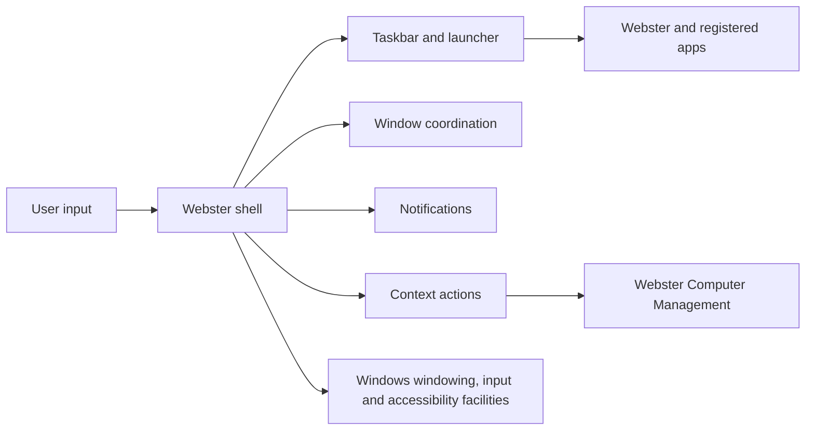

# Desktop Environment

**STATUS: PROPOSED.** Webster Desktop is a user-session environment running on Windows, not a replacement kernel or compositor.

The desktop should provide a predictable work surface, launch and task switching, system status, notifications, settings entry points, keyboard-first navigation and consistent application integration. Windows retains responsibility for session, window manager/compositor, input devices and account token. Webster should coexist with Windows shell components unless a supported product mode is deliberately selected.

The shell fails independently from system services: restartable UI must not trigger privileged operations. Each app exposes title, identity, launch state and accessible controls. See [shell](desktop-shell.md), [windows](window-management.md), and [UI system](user-interface-system.md).
