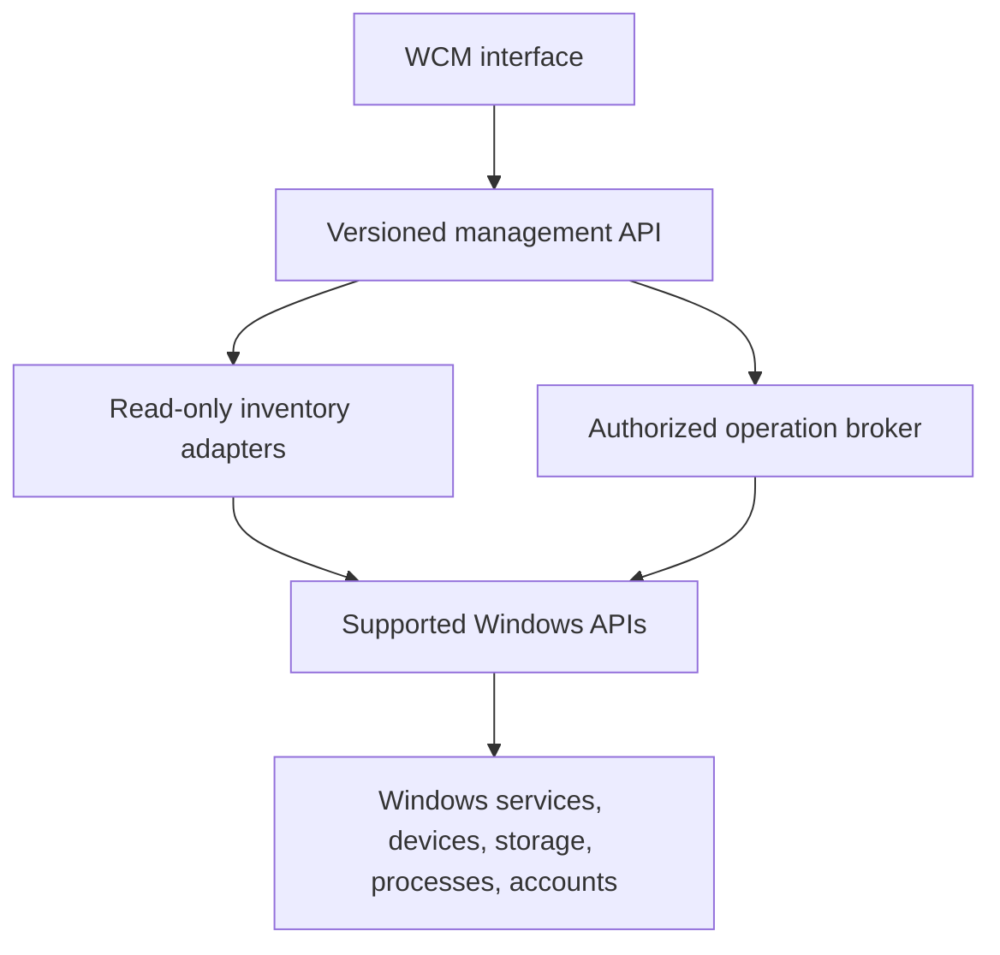

# Webster Computer Management

**STATUS: PROPOSED.** Webster Computer Management (WCM) is a unified administrative console backed by read-only discovery and narrowly authorized operations. It is a Webster application, not Windows Computer Management renamed and not a kernel component.

## Areas

System Tools (information, processes, events, diagnostics and configuration); Storage (disks, partitions, volumes and filesystems); Devices (enumeration, drivers, status and properties); Services (status, dependencies and supported controls); Users and Groups (Windows-backed identity and role view); Performance (CPU, memory, disk, network and processes); Administration (settings, security, logs and recovery).

## Behavior and Safety

Separate discovery from mutation. Display source, timestamp, completeness and access-denied state. Refresh is explicit or bounded; stale values are visibly stale. Mutations preview target and impact, re-check authorization and current state, use supported Windows APIs, confirm success from the platform, and produce an audit record. Destructive disk, account and service actions require stronger confirmation and recovery context. Never bypass UAC, policy or Windows access checks.

## Component and Diagram

The UI calls a versioned API; read-only adapters and a constrained operation broker have separate capabilities. A broker is **DEPENDENCY / FUTURE** until its need is justified and threat-reviewed. Failures are isolated and reported per item; partial enumeration does not become false success. See the dedicated documents in this folder and [Computer Management specification](../../specifications/computer-management-specification.md).
