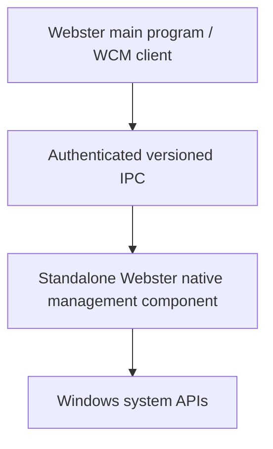

# Standalone Native Components

**STATUS: PROPOSED.** Webster Computer Management may be implemented as a separately installed C++ process. It is not physically embedded in the Webster main program.

## Boundary and Lifecycle

The main program owns presentation and sends typed requests. The independent component owns its process lifecycle and platform adapter calls; it returns structured results. IPC authenticates the OS peer, validates a strict allow-listed operation and parameters, applies authorization per action, enforces size/time limits and logs a correlation ID without secrets.

Do not grant the component blanket administrator privileges. Prefer standard-user read access and use supported consent/elevation for specific changes; if a persistent broker is unavoidable, run under a restricted identity with only required rights. No arbitrary shell, DLL injection or generic “run as admin” IPC.

The installer registers each binary and service only when needed, applies restrictive ACLs, verifies Authenticode/package integrity, and supports clean uninstall. Updates are signed, staged, versioned and rollback-aware. Client/server protocol compatibility is explicit; unknown versions fail closed. Logging rotates, protects sensitive fields and exposes diagnostics. Shutdown drains bounded work and survives client disconnect. Error contracts distinguish denied, unsupported, stale, timeout, partial and platform failure. These lifecycle details remain **PROPOSED**, not implemented. See [native specification](../../specifications/native-component-specification.md).
