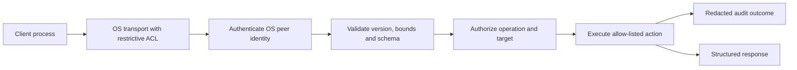

# Secure IPC

**STATUS: REQUIRED** for any future cross-process management interface.

Derive identity from the OS, enforce endpoint ACLs and impersonation rules, reject unknown operations, bound message size and execution time, handle cancellation/disconnects, rate-limit expensive requests, and avoid confused-deputy behavior. Client-supplied identity, path or “admin” flags are never authoritative. Log operation/correlation IDs and outcome, not secrets. Fuzz parser/validation code and test unauthorized peers, malformed input, replay, race and version mismatch. Candidate Windows named pipes require specific ACL and impersonation design before adoption.
