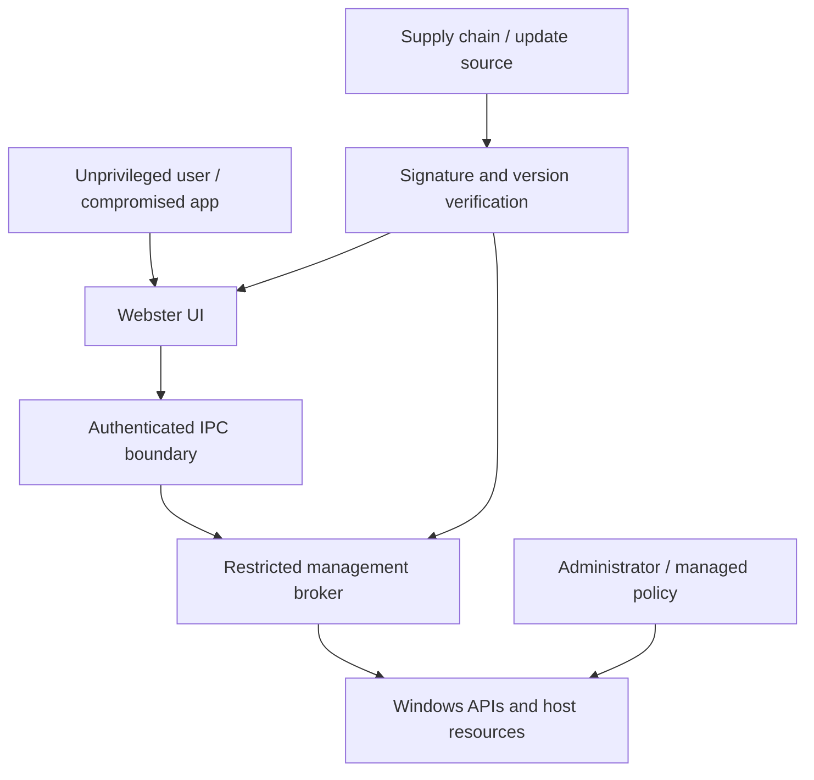

# Threat Model

**STATUS: PROPOSED.** Threat analysis is iterative and required before privileged features ship.

## Assets and Trust Boundaries

Assets: host integrity, credentials/tokens, user files, system configuration, IPC authority, signing material, update pipeline and audit integrity. Boundaries: UI-to-broker IPC, Webster-to-Windows APIs, installer/update, extension loading and user/machine data.

## Adversaries and Abuse Cases

Local standard user attempts privilege escalation; compromised UI tries arbitrary privileged actions; malicious input triggers path/command injection; malicious or downgraded update replaces binaries; dependency compromise; remote actor attacks any listener; administrator/domain policy denies or changes requested operation; logs leak secrets.

## Controls and Residual Risk

Default-deny authorization, Windows identity enforcement, small broker, strict schemas, safe path handling, signed packages, protected installation ACLs, secure DLL loading, privacy-aware audit, dependency inventory, fuzzing and recovery testing. Residual risks include OS vulnerabilities, administrator compromise, API/version variance and supply-chain trust. Maintain attack-surface inventory and review after each new privileged capability.
