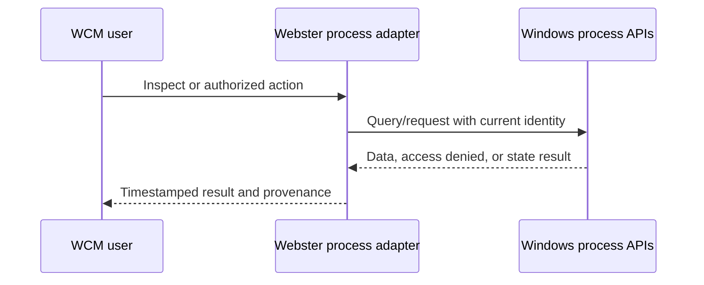

# Process Management

**STATUS: PROPOSED.** Windows owns process creation, scheduling, threads, virtual address spaces, handles and enforcement for integrated phases.

Webster management APIs can enumerate permitted processes, inspect supported metadata/counters, launch identified Webster apps, request authorized termination or priority changes, and correlate process/service state. Show inaccessible/protected process limits and stale samples. Threads, CPU/memory usage, priorities, process handles and associated services are shown only as supported by Windows and caller permissions. Handle values are never persisted or exposed as durable IDs; all handles are RAII-owned with least required access. Avoid injection and arbitrary process-memory access. Resource limits are exposed only where Windows confirms supported job/policy semantics; a requested limit is not reported as active until verified.

See [process model](../01-architecture/process-model.md) and [process isolation](../05-security/process-isolation.md).
