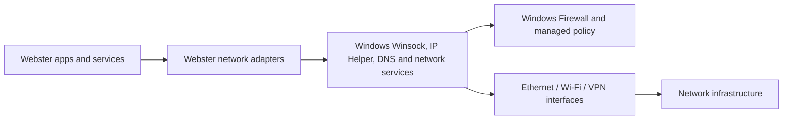

# Networking Architecture

**STATUS: PROPOSED.** Webster is a network-aware Windows application platform; Windows owns NIC drivers, TCP/IP, routing, sockets and core network policy in Phases 1 and 2.

Webster provides status/diagnostics and optional orchestration through supported APIs. Interface inventory includes type, state, address configuration where authorized, DNS/gateway and collection time. Do not promise packet capture or reconfiguration on managed systems. Network UI differentiates link, IP, DNS and remote reachability. See [management](network-management.md), [connectivity](connectivity.md) and [security](../05-security/network-security.md).
