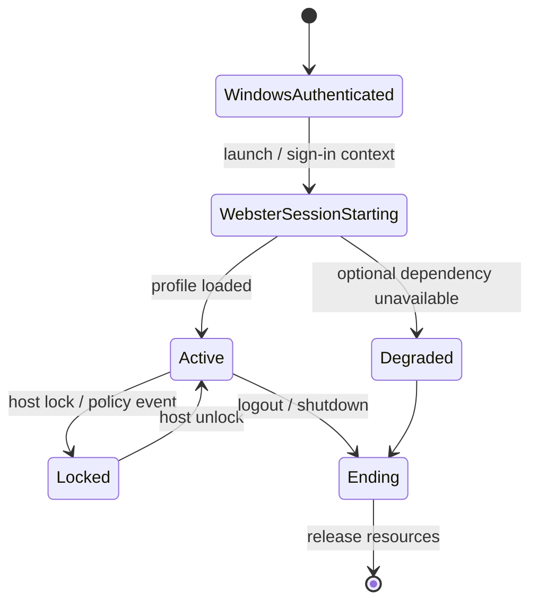

# User Management

**STATUS: PROPOSED.** During Windows-integrated phases, Windows authenticates identities and controls tokens and permissions. Webster maintains application preferences and may present authorized Windows-backed account information.

Account creation, removal, lockout, recovery, group membership and password lifecycle remain Windows/domain responsibilities in Phase 1. Webster must not create a conflicting password store. Application-level roles are separate and cannot confer host privileges. See [accounts](accounts.md), [sessions](sessions.md), [profiles](profiles.md), [groups](groups.md).
