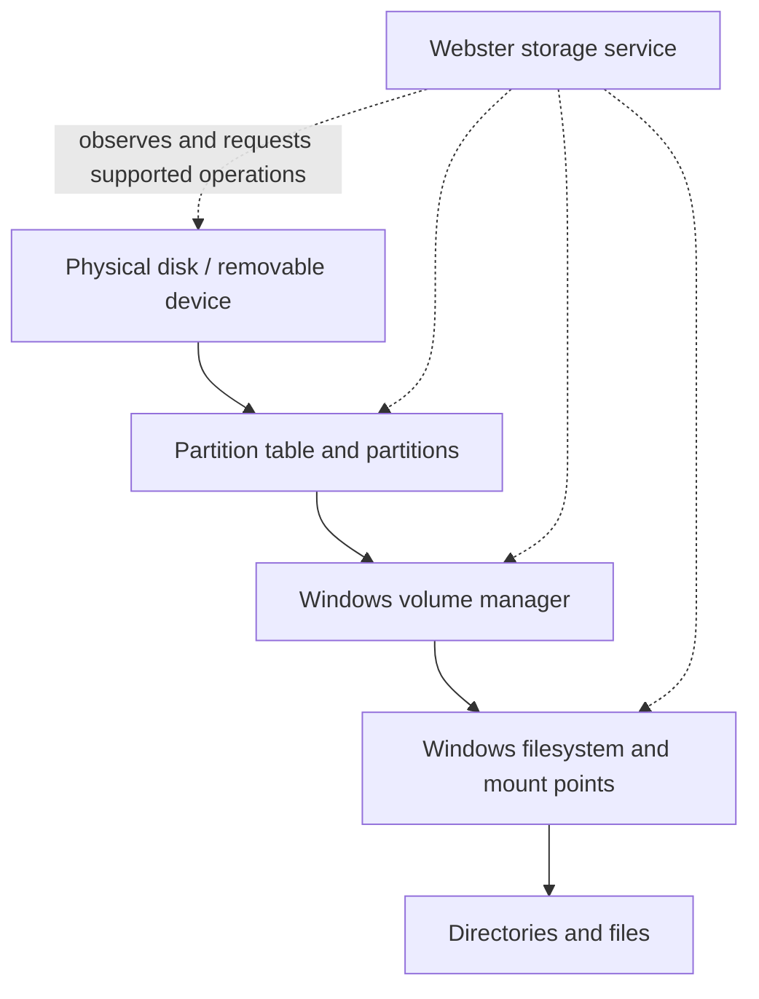

# Storage Architecture

**STATUS: PROPOSED.** Webster models storage and offers safe administration over Windows-owned facilities; it does not define the Phase 1 filesystem or block layer.

Inventory shows the object relationships and provenance. Read-only observation is separate from changes; all destructive operations use fresh identity checks, authorization, confirmation, platform result and recovery guidance. Encryption and health information are shown only when supported and permitted. Windows manages I/O, caching, filesystem consistency, ACLs and mount behavior. See [system storage](../06-system/storage-system.md) and the component pages below.
