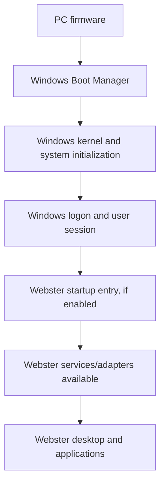

# Boot Architecture

**STATUS: PROPOSED.** Webster does not currently provide a bootloader, kernel or pre-Windows execution environment.

## Windows-Integrated Phase

Windows firmware/boot manager/kernel initialize the machine. Webster starts only after Windows user-session readiness (or an explicitly designed Windows service start); failure to start Webster must not prevent Windows boot or logon.

## Independent OS Direction (FUTURE / RESEARCH)

A future independent architecture might be firmware -> Webster bootloader -> Webster kernel/core -> native services -> Webster system manager -> desktop -> user session. Every component is unimplemented and unspecified at production level. Boot trust, Secure Boot, signed binaries, drivers, hardware support, update/recovery and compatibility require a new decision record and dedicated requirements.
