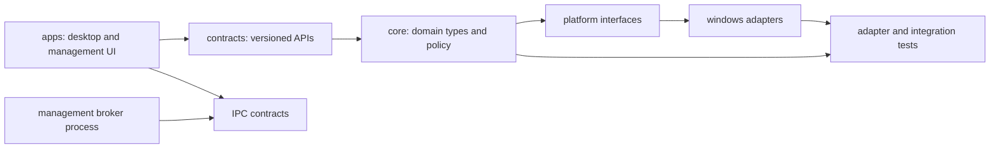

# Repository Architecture

**STATUS: PROPOSED.** The current repository is documentation-only. The future source layout must preserve the separation below.

Possible top-level source directories: `apps/`, `components/`, `contracts/`, `platform/windows/`, `tests/`, `tools/`, `packaging/`, and `docs/`. This is illustrative, not a committed build layout. Keep binaries and generated files out of source control; tests and build tooling are selected with implementation. Each deployable process has explicit entry point, manifest, dependency list, version and owner.
