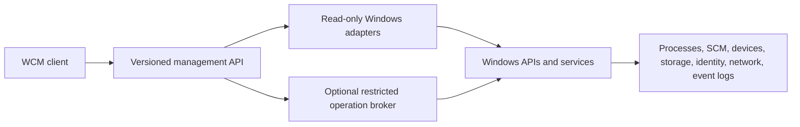

# Webster Computer Management Specification

**STATUS: PROPOSED.** WCM is not implemented; Windows remains authority for underlying host objects.

## Purpose and Scope

Provide a truthful unified console for system information, processes, events, diagnostics/configuration, storage, devices, services, users/groups, performance, security and recovery. The UI is separated from management APIs and any optional standalone broker.

## Architecture and Components

Read-only adapters do not share mutation authority by default. Broker is a separate process if selected; it is not embedded in the Webster main program.

## Interfaces

Inputs: typed filters, scoped resource identity, operation, deadline and correlation ID. Outputs: typed snapshot/job with source, timestamp, status and partial-result indicator. Errors: denied, unsupported, policy blocked, stale, busy, timeout, canceled, partial and platform failure. Security: OS peer identity, endpoint ACL, per-operation authorization, least privilege, revalidation. Version: major/minor contracts; fail closed on unsupported major. Compatibility: capability discovery and optional fields.

## Requirements

- **WEB-CM-001:** WCM MUST separate read-only inventory and mutation capabilities.
- **WEB-CM-002:** Every inventory result MUST carry source, freshness and availability/completeness status.
- **WEB-CM-003:** Process inspection MUST respect Windows access checks and mark protected/inaccessible processes.
- **WEB-CM-004:** Device views MUST use documented PnP/device APIs and MUST NOT load arbitrary drivers.
- **WEB-CM-005:** Storage views MUST distinguish physical disks, partitions, volumes, mount points and filesystems.
- **WEB-CM-006:** Destructive storage operations MUST re-resolve target identity immediately before execution and present scope/impact.
- **WEB-CM-007:** Service controls MUST query dependencies/current state and verify the SCM result.
- **WEB-CM-008:** Account/group actions MUST honor Windows/domain policy and MUST NOT expose credentials.
- **WEB-CM-009:** Performance metrics MUST define units, interval, time and limitations.
- **WEB-CM-010:** Administrative actions MUST be authorized at execution, confirmed when consequential and audited.
- **WEB-CM-011:** Partial enumeration MUST NOT be represented as complete success.
- **WEB-CM-012:** Management IPC MUST NOT expose generic shell or arbitrary command execution.

## Security

Standard-user WCM client; least-privileged adapters; optional broker with allow-listed operations, authenticated IPC, ACLs, rate and size limits, redacted audit, update signing and service lifecycle protections. Windows UAC, access checks and enterprise policy remain authoritative.

## Error Handling

Resource disappearance, policy denial, access denied, unsupported provider, stale observation and uncertain completion are distinct. High-risk operation must return actual platform status; on timeout it may report outcome unknown and require refresh, never assume success.

## Performance

Inventory is paginated, bounded, cancellable and rate-limited; no UI-thread polling. Establish measurable baselines on documented devices. Diagnostic exports are minimal/consented.

## Testing

Unit/schema, standard-user/admin adapter integration, malformed IPC/fuzz, API version mismatch, access-denied and missing-provider tests; destructive workflows only on disposable VMs/test disks; verify audit, recovery and no unrelated host changes.

## Dependencies

Win32 process APIs, SCM, WMI/CIM selectively, SetupAPI/Configuration Manager, storage/volume interfaces, Windows security, Event Log, performance counters, networking APIs, installer/signing and optional UI framework. Availability varies.

## Future Extensions

Remote management, extension panels and deeper Webster-owned system services are future decisions; each expands threat surface and needs new requirements.
