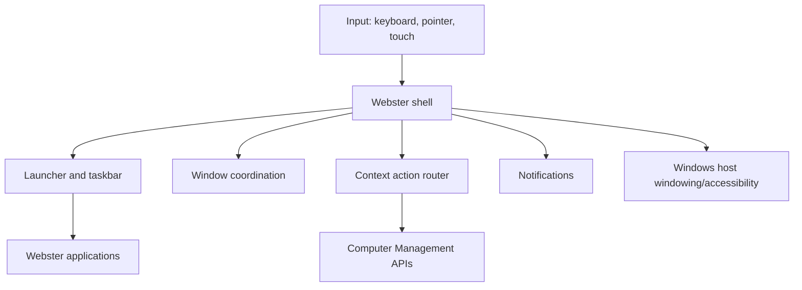

# Webster Desktop Specification

**STATUS: PROPOSED.** No Webster desktop has been implemented.

## Purpose

Define a coherent and accessible Webster user-session experience hosted by Windows.

## Scope

Shell, launch/navigation, windows, taskbar, status/tray, notifications, context menus, settings and system/user controls. Excludes Windows logon, compositor, kernel, drivers and replacement of host accessibility/security facilities.

## Architecture and Components

UI process (standard user) -> desktop/domain API -> optional IPC to services -> Windows windowing/input/notification facilities. Components: shell, taskbar/launcher, window coordination, context action registry, notification center, preferences and accessibility layer. Windows owns actual window/session primitives.

## Interfaces

Shell consumes versioned Desktop API: app identity, launch request, session state, settings, notification and context action. Inputs are typed and bounded; outputs are state/result with errors for unavailable, denied, invalid target or launch failure. Sensitive actions reauthorize on execution. API compatibility follows [desktop architecture](../docs/02-desktop/desktop-environment.md).

## Requirements

- **WEB-DESK-001:** Shell MUST run in Windows user session and not claim logon/compositor ownership.
- **WEB-DESK-002:** Keyboard, mouse and supported touch workflows MUST have predictable accessible behavior.
- **WEB-DESK-003:** Context menu MUST support right-click, context-menu key and Shift+F10; Escape restores focus.
- **WEB-DESK-004:** Context actions MUST be target-aware and distinguish Webster, Windows and privileged commands.
- **WEB-DESK-005:** Launch MUST use registered application identity and safe argument handling; no command-string concatenation.
- **WEB-DESK-006:** UI MUST remain responsive during system queries and show progress/cancel or bounded timeout.
- **WEB-DESK-007:** Notifications MUST respect user/policy settings and not expose sensitive data on shared/locked display absent policy.
- **WEB-DESK-008:** Windows shell coexistence/replacement mode MUST be explicitly selected before release.
- **WEB-DESK-009:** UI MUST honor focus, high contrast, text scaling, screen readers and reduced motion.

## Security

UI is untrusted for authorization; services revalidate all actions. Shell and apps are standard-user. No implicit elevated terminal. Notifications are not credential/elevation interfaces. Extensions, if any, are isolated and untrusted by default.

## Error Handling

Unavailable features, denied actions, stale targets, launch errors and partial results are visible and actionable. UI does not infer success from dispatch. On service crash, shell degrades/reconnects without blocking Windows.

## Performance

No blocking platform calls on UI thread. Set measured launch/input/query budgets before release; cap refresh rates and large result sets.

## Testing

Keyboard/screen-reader, high contrast/scaling/multi-monitor, input modalities, stale state, policy denial, service crash, RDP and Windows shell coexistence tests. Verify context menu close/focus, touch behavior and no unintended command/elevation.

## Dependencies

Windows session/window APIs, selected UI framework and accessibility APIs, application registration and optional notification APIs. Framework remains unselected.

## Future Extensions

Optional widgets, constrained extension contracts and alternate shell mode require separate security and compatibility reviews.
