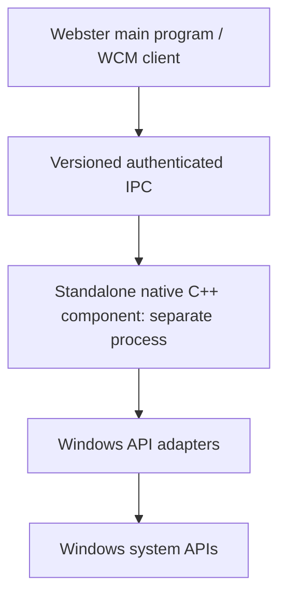

# Webster Native Component Specification

**STATUS: PROPOSED.** The native C++ implementation and standalone management process do not yet exist.

## Purpose and Scope

Specify a modern C++20 user-mode integration layer and optional independently packaged Computer Management process. No kernel-mode code, Webster scheduler or HAL is included in Phase 1.

## Architecture and Components

Core/domain library is platform-neutral where practical; Windows adapter isolates OS headers/handles; broker process is separate from main program and only introduced with security justification.

## Interfaces

Typed C++ internal APIs with cancellation, deadlines and explicit result/error; no exceptions or STL across a public ABI. IPC requests carry version, operation, bounded parameters and correlation ID; response has status, structured result/error and platform context. Inputs are untrusted. Errors: invalid, denied, unsupported, stale, timeout, canceled, partial, incompatible, IO/platform failure. Security: authenticate peer, allow-list operation, authorize using host identity and least privilege. Version negotiation fails closed on unsupported major; staged client/server updates preserve compatibility.

## Requirements

- **WEB-NATIVE-001:** Native baseline MUST target C++20, pinned MSVC and Windows SDK after support validation.
- **WEB-NATIVE-002:** OS handles/resources MUST use RAII wrappers with explicit ownership.
- **WEB-NATIVE-003:** Smart/value ownership MUST be preferred; no unnecessary global mutable state.
- **WEB-NATIVE-004:** Operational failures MUST have stable typed error representation; exceptions MUST NOT cross ABI/IPC.
- **WEB-NATIVE-005:** Windows APIs MUST be documented/supported and encapsulated in testable adapters.
- **WEB-NATIVE-006:** UI, domain, adapter and broker responsibilities MUST remain distinct.
- **WEB-NATIVE-007:** The Computer Management native component MUST be a separately installed process/module when designated standalone, not physically embedded in main program.
- **WEB-NATIVE-008:** Standalone process MUST have explicit lifecycle, identity, ACL-protected endpoint, update/version policy, logs and uninstall path.
- **WEB-NATIVE-009:** Privileged access MUST be narrow, validated, auditable and never exposed as generic command execution.
- **WEB-NATIVE-010:** Threading MUST be bounded, cancellable where feasible and have documented synchronization invariants.
- **WEB-NATIVE-011:** Builds MUST run static analysis and appropriate tests; supported sanitizers are used in compatible configurations.
- **WEB-NATIVE-012:** Logging MUST be structured, correlated and secret-redacted.

## Security

Default standard-user process; separate trusted boundary only for justified operations. Use secure DLL search/loading, restrictive install ACLs, signed packages, no arbitrary plugins in broker, validate paths and parameters, avoid code injection, protect update trust and audit sensitive actions.

## Error Handling and Lifecycle

Startup validates binary/config/protocol; serving is bounded; shutdown drains/cancels work; crash is isolated from Windows boot/logon. Disconnect and uncertain operation completion are reported distinctly. Installer/update verify signatures, stage versions and support rollback; logs rotate and avoid secrets.

## Performance

Bound IPC message sizes, worker count, queues, polling and query latency. Measure startup, resource use, request throughput and shutdown against reproducible baseline before claims.

## Testing

Unit tests for domain/parser/errors; Windows adapter tests under standard/admin contexts; IPC protocol/fuzz/ACL tests; service lifecycle and update/rollback tests; crash, timeout, client disconnect, low-memory and unsupported API tests. Use isolated environments for mutations.

## Dependencies

C++20-capable MSVC, pinned Windows SDK, candidate CMake build, documented Win32/security/SCM/WMI/storage/network/event APIs, signing infrastructure, test framework and potential IPC transport. Final selections remain dependencies/research.

## Future Extensions

C++ modules, service decomposition, extensions and independent OS native components are optional future work; each needs compatibility and security review.
