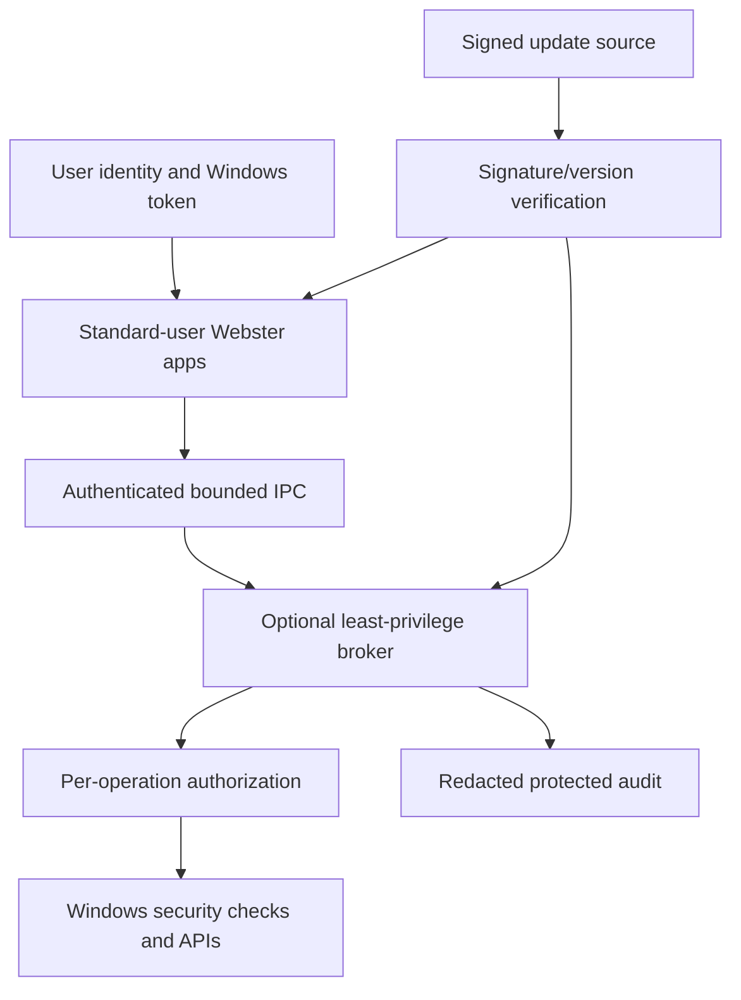

# Webster Security Specification

**STATUS: REQUIRED** as a design baseline; controls are not implemented in this repository.

## Purpose and Scope

Define security boundaries for the Windows-integrated Webster environment, especially native management operations, accounts, IPC, files, network, auditing, installation and updates. Windows remains Phase 1 authentication and resource enforcement authority.

## Architecture and Components

Threat boundaries: app-to-broker, Webster-to-Windows, installer/update, config/data, extension and network interfaces.

## Interfaces

Security API accepts operation, target and caller context; returns allow/deny/reason without leaking secrets. IPC uses OS-authenticated peer identity, restrictive ACLs, strict schemas and bounded operations. Errors distinguish denied, policy, malformed, incompatible and unavailable. Versioned capabilities; unknown privilege requests fail closed.

## Requirements

- **WEB-SEC-001:** Webster UI and routine components MUST run as standard user by default.
- **WEB-SEC-002:** Privileged operations MUST be authorized at the execution boundary and default deny.
- **WEB-SEC-003:** Cross-process IPC MUST authenticate peer identity, validate bounded messages and reject unsupported protocol versions.
- **WEB-SEC-004:** Webster MUST NOT store Windows passwords or silently bypass Windows/domain policy.
- **WEB-SEC-005:** Updates/packages MUST have authenticated integrity and a documented rollback/recovery path.
- **WEB-SEC-006:** Logs MUST exclude credentials/secrets and define access, retention and failure policy.
- **WEB-SEC-013:** Broker MUST expose an allow-list, not arbitrary commands or generic elevated execution.
- **WEB-SEC-014:** Machine binaries/config MUST resist modification by standard users; user data is separated by scope.
- **WEB-SEC-015:** Secrets MUST use supported OS cryptographic protection and MUST NOT appear in logs or command lines.
- **WEB-SEC-016:** Dynamic library/extension loading MUST be constrained, verified and isolated; no unsafe search path.
- **WEB-SEC-017:** Network listeners MUST be absent by default; firewall integration MUST NOT disable Windows protections.
- **WEB-SEC-018:** Each privileged feature MUST have a maintained threat analysis and security test evidence.

## Error Handling

Fail closed on authorization, identity, parsing, signature and version uncertainty. Audit failure policy is operation-class-specific; high-risk mutations may be denied if required audit cannot be recorded. Do not reveal sensitive host details in errors.

## Performance and Reliability

Security checks are synchronous at operation boundary but bounded; signing verification and startup checks cannot cause unsafe fallback. Security controls must not be bypassed for performance.

## Testing

Threat-led review; IPC fuzzing; access-denied/TOCTOU tests; update tampering/downgrade; DLL search order; secrets scanning; low privilege; managed policy; ACL verification; recovery and audit failure scenarios. External assessment is required before broad release of privileged functionality.

## Dependencies

Windows tokens/ACL/UAC, DPAPI/CNG where appropriate, Authenticode/code signing, supported firewall/event APIs, secure installer/update infrastructure and dependency vulnerability process.

## Future Extensions

Independent Webster authentication, kernel security authority and remote administration require separate threat model, key lifecycle and requirements; not assumed by this baseline.
